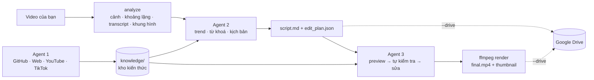

# vedit — hệ thống 3 agent dựng, chỉnh sửa & lên kịch bản video ngắn

`vedit` biến một video thô của bạn thành video ngắn (TikTok / Reels / Shorts / YouTube) hoàn chỉnh,
bằng 3 agent dùng Claude + ffmpeg:

| Agent | Lệnh | Làm gì |
|---|---|---|
| **Agent 1 — Nghiên cứu** | `vedit research` | Tìm hiểu kỹ thuật edit trên **GitHub, web, YouTube, TikTok**, chắt lọc thành ghi chú trong kho kiến thức `knowledge/` |
| **Agent 2 — Trend & kịch bản** | `vedit script` | Phân tích video bạn đưa vào, nghiên cứu **trend, từ khoá, hashtag** hiện tại, viết **kịch bản** + **EditPlan** (kế hoạch dựng); tuỳ chọn tạo **thư mục Google Drive** |
| **Agent 3 — Dựng & xuất** | `vedit edit` | Dựng theo EditPlan, render bản xem trước, **tự xem lại khung hình để sửa lỗi**, rồi **xuất video** + thumbnail |



## Cài đặt

Cần **Python 3.10+** và **ffmpeg** (có libass — bản phổ thông đều có).

```bash
# macOS: brew install ffmpeg      Ubuntu: sudo apt install ffmpeg      Windows: winget install ffmpeg
git clone https://github.com/HuyenTrinh147/Claude_edit.git && cd Claude_edit
python -m venv .venv && source .venv/bin/activate      # Windows: .venv\Scripts\activate
pip install -e ".[gdrive,transcribe]"                  # bỏ extra nào không cần
cp .env.example .env                                   # rồi điền ANTHROPIC_API_KEY
vedit doctor                                           # kiểm tra môi trường
```

- `transcribe` cài **faster-whisper** để tự nhận dạng lời nói → phụ đề karaoke, cắt khoảng lặng theo lời. Không cài
  thì có thể đưa file `.srt` sẵn có qua `--transcript`.
- `gdrive` cài thư viện Google để tạo thư mục / tải file lên Drive.

## Dùng nhanh

```bash
# 1 lệnh: phân tích → Agent 2 viết kịch bản theo trend → Agent 3 dựng & xuất (→ Drive)
vedit make ~/Videos/quan-cafe.mp4 \
  --goal "Review quán cà phê 20k ở quận 1, thu hút sinh viên đến quán" \
  --platform tiktok --duration 30 --style "năng động, hài hước" --drive
```

Kết quả nằm trong `projects/<ngày>-<tên>/`:

```
projects/20261030-quan-cafe/
├── project.json          # thông tin dự án, link Google Drive
├── analysis/             # analysis.json + khung hình đại diện
├── script/script.md      # kịch bản dễ đọc: hook, insight trend, bảng cảnh, caption, hashtag
├── script/script.json
├── edit_plan.json        # kế hoạch dựng (Agent 3 render từ file này)
└── renders/final.mp4     # video xuất + final.jpg (thumbnail), preview.mp4
```

### Từng bước (khi muốn kiểm soát)

```bash
vedit research "kỹ thuật cắt nhịp nhanh và phụ đề karaoke cho TikTok" --depth standard   # Agent 1
vedit kb list                       # xem kho kiến thức  (vedit kb search hook / vedit kb show <ref>)

vedit script ~/Videos/quan-cafe.mp4 --goal "..." --platform reels --duration 45          # Agent 2
#   → đọc & sửa tay projects/<dự án>/script/script.md hoặc edit_plan.json nếu muốn

vedit edit 20261030-quan-cafe                                                            # Agent 3
vedit edit quan-cafe -i "chữ hook to hơn, bỏ cảnh thứ 3, thêm zoom chậm ở cảnh cuối"      # chỉnh bằng lời

vedit render quan-cafe --preview    # render lại không cần AI (nhanh, nửa độ phân giải)
vedit validate quan-cafe            # kiểm tra edit_plan.json sau khi sửa tay
vedit drive sync quan-cafe          # tải kịch bản + video lên Google Drive
vedit projects                      # danh sách dự án & trạng thái
```

## Chi tiết 3 agent

### Agent 1 — Nghiên cứu (`vedit research "<chủ đề>"`)
- Công cụ: `web_search`/`web_fetch` (chạy phía server của Anthropic), tìm repo + đọc README GitHub, tìm video +
  đọc transcript YouTube, đọc số liệu/hashtag video TikTok (qua `yt-dlp`), đọc/ghi kho kiến thức.
- Ghi chú lưu ở `knowledge/<nhóm>/<slug>.md` (có nguồn, tags, ngày cập nhật) + mục lục `knowledge/INDEX.md`.
  Nhóm: `techniques`, `scripting`, `trends`, `platforms`, `audio`, `tools`, `ffmpeg`.
- `--depth quick|standard|deep` quyết định số nguồn; `--focus github youtube` để ưu tiên nguồn.
- Kho có sẵn 7 ghi chú khởi tạo (hook, cấu trúc kịch bản, vùng an toàn, nhịp cắt, âm thanh, công thức ffmpeg,
  repo hữu ích) — chạy Agent 1 để kiểm chứng và mở rộng.

### Agent 2 — Trend & kịch bản (`vedit script <video|dự án> --goal "..."`)
1. **Phân tích video** (không dùng AI, `vedit analyze`): thông số, dò cảnh, khoảng lặng, transcript, khung hình đại diện.
2. Claude **xem khung hình**, đọc transcript, **nghiên cứu xu hướng thật** gần đây (web, YouTube, TikTok, kho kiến
   thức), chọn ý tưởng → viết kịch bản: phương án tiêu đề & hook, insight trend có dẫn nguồn, bảng cảnh (thời gian,
   hình ảnh, lời thoại, chữ trên màn hình, ghi chú dựng), nhạc, CTA, caption, hashtag, từ khoá, mẹo đăng.
3. Viết **EditPlan** khớp kịch bản. EditPlan được kiểm tra với file thật (điểm cắt có vượt độ dài không, file có
   tồn tại không...) — sai thì Claude tự sửa.
4. `--drive`: tạo `vedit/<dự án>/{01_Nguon, 02_Kich_ban, 03_Video_xuat}` trên Google Drive và tải `script.md`
   (thành Google Docs), `script.json`, `edit_plan.json` lên.

### Agent 3 — Dựng & xuất (`vedit edit <dự án> [-i "yêu cầu"]`)
- Đọc EditPlan, áp dụng yêu cầu chỉnh sửa bằng lời (nếu có), **render preview** rồi **nhìn các khung hình mẫu**
  để kiểm tra: chữ bị cắt/đè mặt/nằm dưới giao diện app, crop mất chủ thể, sai cảnh, lệch phụ đề... → sửa → render lại.
- `render_final`: xuất H.264/AAC, loudness -14 LUFS, `faststart`, kèm thumbnail. Nếu agent quên xuất, hệ thống tự
  render từ EditPlan đã lưu.

## EditPlan — "ngôn ngữ chung" giữa Agent 2 và Agent 3

Một file JSON mô tả toàn bộ video. Ví dụ rút gọn (`vedit schema plan` in đầy đủ schema):

```json
{
  "title": "Quán cà phê 20k",
  "sources": {"main": "/Users/ban/Videos/quan-cafe.mp4"},
  "canvas": {"width": 1080, "height": 1920, "fps": 30},
  "clips": [
    {"source": "main", "start": 12.4, "end": 14.9, "fit": "cover", "focus_x": 0.4, "zoom": "in", "note": "hook"},
    {"source": "main", "start": 31.0, "end": 34.2, "fit": "blur"},
    {"source": "main", "start": 50.5, "end": 55.0, "speed": 1.5, "transition": {"type": "fade", "duration": 0.3}},
    {"source": "color:#111111", "duration": 1.5, "note": "thẻ CTA"}
  ],
  "texts": [{"text": "Chỉ 20k mà như này?", "start": 0, "end": 2.4, "position": "upper", "size": 96, "animation": "pop"}],
  "captions": {"style": "karaoke", "segments": [{"start": 0.2, "end": 1.9, "text": "Xin chào các bạn"}]},
  "images": [{"path": "assets/logo.png", "x": 0.88, "y": 0.06, "width": 0.14, "opacity": 0.9}],
  "audio": [{"path": "assets/music/lofi.mp3", "role": "music", "volume": 0.2, "duck": true}],
  "export": {"filename": "final.mp4", "crf": 20, "thumbnail_at": 1.0}
}
```

- `clips` nối tiếp nhau; `start/end` là **giây trong file nguồn**. `texts`, `captions`, `images`, `audio` dùng
  **giây trên timeline** của video xuất.
- `fit`: `cover` (cắt đầy khung, chỉnh `focus_x/focus_y`), `contain` (viền màu), `blur` (nền mờ — hợp khi đưa video
  ngang sang dọc). `zoom`: `in`/`out` (Ken Burns). `speed` 0.25–4. `transition`: `fade`, `slideleft`, `zoomin`,
  `circleopen`... (chuyển cảnh từ clip trước).
- Chữ & phụ đề render bằng **libass**: tiếng Việt có dấu, viền, hộp nền, hiệu ứng `pop` / `fade` / `slide_up`;
  phụ đề `clean`, `boxed`, `bold_pop`, `karaoke` (tô màu từ đang đọc).
- Âm thanh: nhạc nền tự **giảm âm lượng khi có lời nói** (`duck`), fade in/out, lặp; voiceover/SFX đặt theo mốc.

## Google Drive

Agent 2 chỉ cần **tạo thư mục và tải file** nên dùng quyền hẹp `drive.file` (chỉ thấy file do vedit tạo).

1. Vào [Google Cloud Console](https://console.cloud.google.com/) → tạo project → **APIs & Services → Enable APIs** → bật **Google Drive API**.
2. **OAuth consent screen**: chọn External, thêm email của bạn vào *Test users*.
3. **Credentials → Create credentials → OAuth client ID → Desktop app** → tải file JSON về `secrets/client_secret.json`.
4. Trong `.env`: `GOOGLE_OAUTH_CLIENT_FILE=./secrets/client_secret.json`.
5. Chạy `vedit drive setup <dự án>` lần đầu → trình duyệt mở để đăng nhập; token được lưu lại cho các lần sau.

(Service account cũng được hỗ trợ — xem `.env.example` — nhưng service account không có dung lượng riêng, nên phải
dùng thư mục trong Shared Drive.)

## Dùng ngay trong Claude Code

Thư mục `.claude/agents/` có 3 subagent tương ứng (`video-researcher`, `video-scriptwriter`, `video-editor`).
Trong Claude Code, chỉ cần nói ví dụ *"dùng video-scriptwriter lên kịch bản TikTok cho video ~/Videos/a.mp4"*.
Các subagent này dùng công cụ web và Bash có sẵn của Claude Code cùng các lệnh `vedit analyze / validate / render`,
nên **không cần ANTHROPIC_API_KEY riêng**. Nếu Claude Code có kết nối Google Drive, subagent kịch bản cũng có thể
lưu kịch bản lên Drive qua kết nối đó.

## Cấu hình & chi phí

- Mặc định model `claude-opus-5-5`, adaptive thinking; mức `effort` riêng từng agent (`VEDIT_EFFORT_*` trong `.env`):
  research `medium`, script `high`, edit `medium`. Hạ xuống `low` để tiết kiệm, nâng `high`/`xhigh` khi cần chất lượng.
- Prompt caching được bật cho cả system prompt và hội thoại; cuối mỗi lần chạy agent in số token đã dùng.
- `VEDIT_FALLBACKS=1`: nếu bộ lọc an toàn từ chối một lượt, API tự chạy lại lượt đó trên model dự phòng (đặt `0` để tắt).
- Web search/fetch tính phí theo lượt dùng; mỗi agent có giới hạn `max_uses`.

## Giới hạn cần biết

- **TikTok không có API tìm kiếm công khai**: Agent tìm link qua web search rồi đọc từng video bằng `yt-dlp`;
  TikTok/YouTube đôi khi chặn truy cập tự động — agent sẽ tự chuyển sang web search/web fetch.
- Claude **không nghe được âm thanh**: lời nói chỉ được hiểu qua transcript (faster-whisper hoặc file `.srt`).
- Emoji hiển thị dạng nét đơn sắc (libass không vẽ emoji màu).
- Nhạc trend trong app thường không được phép chèn sẵn vào file — Agent 2 ghi hướng dẫn chọn sound trong kịch bản.

## Phát triển

```bash
pip install -e ".[dev]"
pytest            # 30+ test: schema, ffmpeg render thật trên video tổng hợp, phân tích media,
                  # kho kiến thức, vòng lặp agent với API giả lập (không tốn phí)
```

Mã nguồn: `vedit/edl.py` (schema EditPlan) · `vedit/render.py` (ffmpeg + ASS) · `vedit/media.py` (phân tích) ·
`vedit/agents/` (3 agent + công cụ) · `vedit/knowledge.py` · `vedit/gdrive.py` · `vedit/cli.py`.
